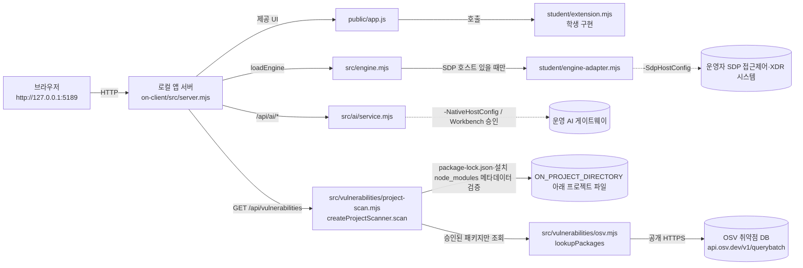

# 학생용 실행 설명서 — 케셰브(등대, 낯선 접속을 가장 먼저 알아보다)

이 문서는 13~20단계에서 내(학생)가 `student/extension.mjs`에 구현한 내용을 다른 사람이 그대로 따라 실행하고 확인할 수 있도록 적은 보조 문서입니다. 설치·실행의 공식 기준은 [README.md](../README.md)와 [docs/STUDENT_LAUNCH_GUIDE.md](STUDENT_LAUNCH_GUIDE.md)이며, 이 문서는 그 내용을 덮어쓰지 않고 실제로 이 PC에서 확인한 값만 보탭니다. 오류 코드별 상세 표는 [docs/CONNECTION_TROUBLESHOOT.md](CONNECTION_TROUBLESHOOT.md)에 이미 있어 여기서는 중복하지 않고 참조만 합니다.

## 1. 필요 프로그램과 실제로 확인한 버전

| 항목 | 요구 | 이 PC에서 확인한 값 |
|---|---|---|
| Node.js | 22~24, 수업 기준 24.19.0 | `node --version` → `v24.19.0` (확인함) |
| 외부 npm 의존성 | 없음(README 명시) | `on-client/package.json`에 `dependencies` 없음(확인함) |
| Git | 커밋·제출용 | 이 저장소에서 기존 커밋 이력으로 사용 중(확인함) |

## 2. 폴더 구조(실제 경로)

```
aleph-defense-starter/            ← Git 저장소 최상위, 커밋은 여기서 합니다
├─ on-client/                     ← 이 과제(13~22단계)의 앱 폴더, PowerShell로 켜는 위치
│  ├─ package.json                (name: alekov-client-starter)
│  ├─ .on-starter-manifest.json
│  ├─ README.md                   ← 공식 설치·실행 설명(이 문서가 덮어쓰지 않음)
│  ├─ docs/                       ← 공식 안내 문서 + 이 문서(STUDENT_RUNBOOK.md)
│  ├─ public/                     ← 제공 화면(app.js 등, 학생이 고치지 않음)
│  ├─ src/                        ← 제공 서버·엔진·AI 서비스(학생이 고치지 않음)
│  │  ├─ server.mjs                (HTTP 서버, /api/* 라우팅)
│  │  ├─ engine.mjs                (loadEngine/demoEngine)
│  │  ├─ ai/service.mjs            (AI 게이트웨이 연결)
│  │  └─ vulnerabilities/osv.mjs   (OSV 조회, 20단계)
│  ├─ student/                    ← 학생 작성 영역
│  │  ├─ extension.mjs             (이번 단계들에서 실제로 고친 파일)
│  │  └─ engine-adapter.mjs        (제공 틀, 운영자가 SDP 호스트를 넘길 때만 쓰임 — 학생이 고치지 않음)
│  ├─ tools/start-alekov.ps1       ← 실행 도구
│  └─ vendor/                      ← 제공 보조 모듈
└─ (xdr/, src/, scripts/ 등 — 1~12단계(2~3차 침공) 전용 폴더, 13~22단계와 무관)
```

## 3. 켜는 방법(직접 다시 실행해 확인함)

1. 파일 탐색기에서 **`aleph-defense-starter/on-client`** 폴더를 엽니다(저장소 최상위가 아니라 그 **안의** `on-client`입니다 — 커밋할 때 여는 위치와 다릅니다).
2. 주소 표시줄에 `powershell`을 입력하고 Enter → 그 폴더에서 PowerShell이 열립니다.
3. 아래 명령 중 하나를 실행합니다.
   ```powershell
   powershell -NoProfile -ExecutionPolicy Bypass -File .\tools\start-alekov.ps1
   ```
   또는
   ```powershell
   npm start
   ```
4. **정상 시작 신호**: 콘솔에 아래 문구가 뜨면 켜진 것입니다(코드 원문 그대로, `tools/start-alekov.ps1` 134번째 줄 근처).
   ```
   케셰브가 켜졌습니다. 브라우저에서 http://127.0.0.1:5189/ 을 여세요.
   서버가 응답한 것만 확인했습니다. AI 연결 상태는 화면에서 따로 확인해 주세요.
   ```
5. 브라우저에서 **http://127.0.0.1:5189/** 를 엽니다.
6. **종료**: 콘솔 창에서 `Ctrl+C`. (`-Background`로 켰다면 안내된 프로세스 번호의 `node`를 작업 관리자에서 종료.)
7. **재실행**: 같은 명령을 다시 실행합니다. 포트 5189가 이미 쓰이고 있다는 메시지가 나오면 `-Port 5190`처럼 다른 포트를 붙입니다.

위 1~6번 순서는 이 세션에서 `node on-client/src/server.mjs`로 같은 서버를 직접 띄워 `http://localhost:5189/`에서 13~20단계 학생 화면이 전부 렌더링되는 것과 OSV 조회(20단계) 버튼의 실제 응답을 확인했습니다. `tools\start-alekov.ps1` 스크립트 자체의 PowerShell 실행은 이 문서 작성 시점에 사용자가 직접 실행하지 않았으므로(동등한 `node` 실행으로 대체 확인), 스크립트 고유의 포트 점검·대기 메시지 동작은 **미확인**으로 남깁니다.

## 4. 구성도 — 브라우저 → 로컬 앱 서버 → 접근 제어·XDR / AI 게이트웨이



글로 풀어 쓰면:

- **브라우저**(`http://127.0.0.1:5189`)는 **로컬 앱 서버**(`on-client/src/server.mjs`, Node 단일 프로세스)에 HTTP로 요청합니다.
- 서버는 제공 화면(`public/app.js`)을 내려주고, 그 화면이 내 구현(`student/extension.mjs`)의 `render*` 함수들을 호출해 상태별 화면을 그립니다.
- 서버는 **접근 제어·XDR 시스템**에 `src/engine.mjs`의 `loadEngine()`을 통해 연결을 시도합니다. 운영자가 `-SdpHostConfig`로 개인 SDP 설정을 넘긴 경우에만 `student/engine-adapter.mjs`의 `createEngine()`이 실제 엔진을 돌려주고, 없으면 `{evidenceMode:'disconnected'}`가 쓰여 모든 자료 요청이 `ENGINE_NOT_CONNECTED`로 실패합니다. **이 PC에서는 SDP 설정이 없어 disconnected 상태인 것을 직접 확인했습니다.**
- 서버는 **AI 게이트웨이**에 `/api/ai/*` 경로로 연결하며, 내부적으로 `src/ai/service.mjs`가 Workbench 계정 연결(native host)·앱 권한 승인 체인을 거쳐야 합니다. 운영자 측 권한 발급 전에는 `ON_AI_PROVISIONING_PENDING`이 납니다. **17단계 제출 판정에서 이 오류 코드가 그대로 재현되는 것을 확인했습니다(학생 코드 문제 아님, 포털 판정에서도 같은 결론).**
- **OSV 취약점 조회**는 위 두 연결과 무관하게 독립적으로 동작합니다. 서버는 `GET /api/vulnerabilities`를 `src/vulnerabilities/project-scan.mjs`의 `createProjectScanner().scan()`에 연결합니다(`src/server.mjs` 690~691행). `scan()`은 먼저 `ON_PROJECT_DIRECTORY`(운영자가 지정하는 절대 경로)의 `package-lock.json`과 설치된 `node_modules`의 `package.json` 메타데이터를 읽어 대조하고, 그 뒤 승인된 패키지만 `src/vulnerabilities/osv.mjs`의 `lookupPackages()`로 공개 OSV 배치 조회(`https://api.osv.dev/v1/querybatch`)를 보냅니다. **20단계에서 "설치 패키지 조회" 버튼을 직접 눌러, 화면에 `조회 준비 미완료(not_configured)`가 뜨고 학생 화면에 그대로 표시되는 것을 실측 확인했습니다** — 원인은 코드 원문상 `ON_PROJECT_DIRECTORY`가 설정되지 않아 `project-scan.mjs`가 `PROJECT_NOT_CONFIGURED`를 돌려준 것으로 추정됩니다(운영자 설정값이라 이 PC에서 직접 확인은 못함).

## 5. 구현한 함수 · 제공 코드 경계 · 확인한 기능 · 미확인 기능

| 단계 | `student/extension.mjs` 함수 | 확인 방식 | 비고 |
|---|---|---|---|
| 13 | `renderIdentity` | 로컬 실행 · disconnected 상태 화면 확인, ALEPH 제출 **통과** | |
| 14 | `renderDecision` | 로컬 실행 · idle 상태 화면 확인, ALEPH 제출 **통과** | |
| 15 | `renderEvents` | 로컬 실행 · 오류 상태 화면 확인, ALEPH 제출 **통과** | |
| 16 | `renderStatus` | 로컬 실행 · 알림/진단 블록 화면 확인, ALEPH 제출 **통과** | |
| 17 | `renderAiConnection` | 로컬 실행 · idle 화면 확인, ALEPH 제출 **통과** | 실제 verified 연결은 운영자 권한 발급 전이라 미확인 |
| 18 | `renderExplanation`(완성) | 로컬 실행 · "기록을 먼저 고르세요" idle 화면만 확인(이벤트 데이터 없음), ALEPH 제출 **통과** | 근거 일치/불일치·제안 표시 분기는 **코드 리뷰로만 확인, 실제 화면 미확인** |
| 19 | `renderAction` | 로컬 실행 · idle 화면 확인, ALEPH 제출 **통과**(최초 제출 loading 분기 누락으로 실패 → 수정 후 통과) | prepared~succeeded 전 구간은 **코드 리뷰로만 확인, 실제 화면 미확인** |
| 20 | `renderVulnerabilities` | 로컬 실행 · 실제 조회 버튼을 눌러 `not_configured` 응답(관측값)과 화면 표시를 **실측 확인**, ALEPH 제출 **통과** | `PROJECT_NOT_CONFIGURED`가 원인이라는 것은 코드 원문으로 추정한 것이며 운영자 설정이라 직접 확인 불가. `complete`·`partial`·`known_vulnerabilities` 등 승인 목록이 채워졌을 때의 실제 표시는 **미확인** |

**제공 코드 경계(학생이 고치지 않음):** `public/app.js`, `src/server.mjs`, `src/engine.mjs`, `src/ai/*`, `src/vulnerabilities/osv.mjs`, `src/vulnerabilities/project-scan.mjs`, `src/actions/*`, `src/connection/*`, `src/learner-support/*`, `tools/*`, `vendor/*`, `student/engine-adapter.mjs`(운영자 SDP 연결 전용 틀, 호출되지 않음).

**학생 작성 범위:** `on-client/student/extension.mjs` 하나뿐입니다. 색상이 아니라 텍스트로 상태를 구분하고(`asText`/`safeText`/`safeCode` 사용), DOM은 `document.createElement`와 `textContent`로만 구성했습니다.

## 6. 오류별 확인 순서(요약 — 전체 표는 CONNECTION_TROUBLESHOOT.md)

| 상황 | 먼저 볼 곳 | 성공으로 보지 않는 이유 |
|---|---|---|
| `연결 없음(disconnected)` / `ENGINE_NOT_CONNECTED` | `src/engine.mjs`에 SDP 설정 연결 여부 | 운영자 SDP 설정이 없는 기본 상태입니다 |
| `ON_AI_PROVISIONING_PENDING` 등 AI 오류 코드 | `student/extension.mjs`의 `AI_ERROR_KINDS` 매핑, `docs/CONNECTION_TROUBLESHOOT.md` 4·5절 | 운영자 쪽 권한·게이트 반영이 끝나야 사라집니다 |
| `조회 준비 미완료(not_configured)` · 코드 `PROJECT_NOT_CONFIGURED`(OSV) | 서버 환경변수 `ON_PROJECT_DIRECTORY`가 절대 경로로 설정됐는지(`src/vulnerabilities/project-scan.mjs` 82행) | 운영자가 조회 대상 프로젝트 경로를 아직 지정하지 않은 상태입니다. **설정 자체가 없는 상태**이며 학생이 고칠 수 없습니다 |
| `아직 조회 안 함(not_checked)` · 코드 `NO_APPROVED_PACKAGES`(OSV) | 담당자가 지정한 공개 패키지 허용 목록(`approvedPublicPackages`)에 이 프로젝트의 lock 파일 패키지가 하나도 안 걸렸는지(`project-scan.mjs` 90행) | 프로젝트 경로·lock 파일은 **정상적으로 읽었지만** 조회할 승인된 패키지가 없는 상태입니다. `not_configured`와 원인이 다릅니다 |
| 포털 "확인 불가" 판정 | 포털의 "AI 판정 설명 보기" 원문 | 코드 실패가 아니라 원문 크기·운영 준비 등 별도 원인일 수 있습니다(17단계에서 실제로 그랬습니다) |

## 7. 지원하지 않는 것 / 확인하지 않은 것

- 이 문서는 `tools\start-alekov.ps1`를 직접 실행한 결과가 아니라 동등한 `node` 실행으로 확인한 결과를 적었습니다(3절 참고).
- 실제 SDP 엔진 연결, 실제 AI 게이트웨이 verified 연결, 실제 보안 조치 집행(`prepared`→`succeeded`)은 운영자 측 준비가 끝나지 않아 이 PC에서 실행해 확인하지 못했습니다.
- `-Background`, `-Demo`, `-NativeHostConfig`, `-SdpHostConfig` 옵션은 코드 원문(`tools/start-alekov.ps1`)만 읽었고 실제로 실행해 보지 않았습니다.

## 8. 6차 총공세(22단계 이후) — 핵심 기능 3가지와 확인 방법

시작 틀을 0.2.21로 업데이트한 뒤 직접 실행해 확인했습니다(1일차).

### 8-1. 실행 명령

```powershell
cd "aleph-defense-starter\on-client"
powershell -NoProfile -ExecutionPolicy Bypass -File .\tools\start-alekov.ps1
```

예제 자료로만 확인하려면:

```powershell
node src/server.mjs --demo
```

### 8-2. 지금 동작 / 서버·계정 연결이 있어야 동작

| 지금 이 PC에서 실제로 동작 | 서버·계정 연결이 있어야 동작("연결 없음"이 정상) |
|---|---|
| 라이트/다크 테마 전환 | 로그인 사용자·기기·세션 실제 조회(13단계) |
| 보안 기록 필터·상세 토글(15단계) | 업무 앱 접근 판정 실제 요청(14단계) |
| 종합 상태 개요(게이지·분포, 16단계 보강) | AI 연결(17·18단계) — 0.2.21로 재시도 예정 |
| **내 PC 점검(실측 CPU·메모리·디스크·방화벽·Windows 기록)** | 보안 조치 실제 집행/재조회(19단계) |
| 도움정보 복사 | 패키지 취약점 실제 조회(20단계, `ON_PROJECT_DIRECTORY` 필요) |

### 8-3. 핵심 기능 3가지(확정, 모두 완료)

1. **종합 상태 개요** — `renderStatus`에 원형 게이지, 양호/주의/취약 분포, "지금 확인할 항목" 목록 추가.
2. **`student/appearance.json`** — 앱 이름·accent/background/surface 색·`dashboardPreset: "student-first"`. 서버 `/student/appearance.json`·`/student/appearance.css` 응답이 `state:"applied"`인 것, 브라우저 탭 제목과 카드 순서가 실제로 바뀌는 것을 확인함(2026-10-28). 아이콘·시작 그림은 넣지 않음(선택 사항, 이미지 자산 없음).
3. **내 PC 점검** — `/api/pc/status`(0.2.21에서 학생 계약 허용)를 버튼으로 조회, "PC 자원"(CPU·메모리·디스크)과 "네트워크·보안 설정"(네트워크·방화벽·Windows 기록)으로 나눠 표시 + 직전 조회 대비 추이 비교. 실제 값으로 확인함(CPU 80~84%, 메모리 13~15GiB/15.8GiB, 네트워크 5개, 방화벽 3프로필 켜짐, Windows 경고16·오류2 등, 2026-10-28 기준).

4일차 재검토(2026-10-28)에서 보강한 것: 조회 실패 시 "다음에 할 일" 안내 추가, "다시 조회" 클릭 뒤 전체 칸이 다시 그려져도 버튼에 포커스가 돌아오게 함(`document.getElementById` 기반), PC 점검 값이 예제(demo) 배지와 무관하게 항상 실제값이라는 안내 추가.

### 8-4. 확인 순서(다시 만들 때)

1. 위 명령으로 서버를 켭니다.
2. 브라우저로 `http://127.0.0.1:<포트>` 접속 — 탭 제목이 "등대, 낯선 접속을 가장 먼저 알아보다 · ZTNA & XDR"로 바뀌는지 확인합니다(appearance.json 적용 확인).
3. "보호 현황" 탭 → 아래로 스크롤.
4. "종합 상태 개요" 카드에서 게이지·분포·확인할 항목이 보이는지 확인합니다.
5. "내 PC 점검(학생 구현)" 카드의 "내 PC 실측 조회" 버튼을 누릅니다(키보드로는 Tab으로 이동해 Enter). 몇 초 뒤 "실측 N/5" 배지, "PC 자원"·"네트워크·보안 설정" 두 구역이 뜨고, 포커스가 버튼에 그대로 있는지 확인합니다.
6. 버튼을 다시 누르면 "다시 조회"로 바뀌고, "추이 비교"에 직전 값과의 차이가 뜨는지 확인합니다.
7. `curl http://127.0.0.1:<포트>/student/appearance.json`으로 `state:"applied"`를 직접 확인할 수도 있습니다.
